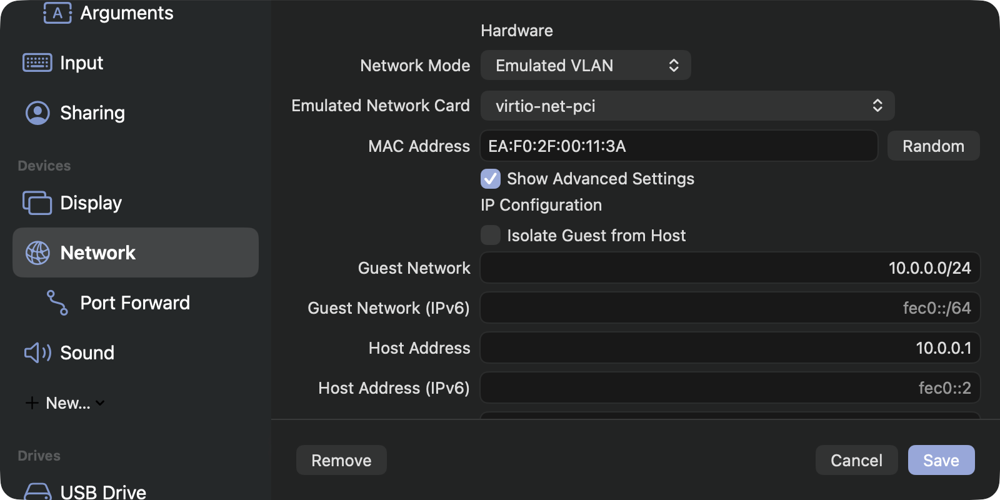
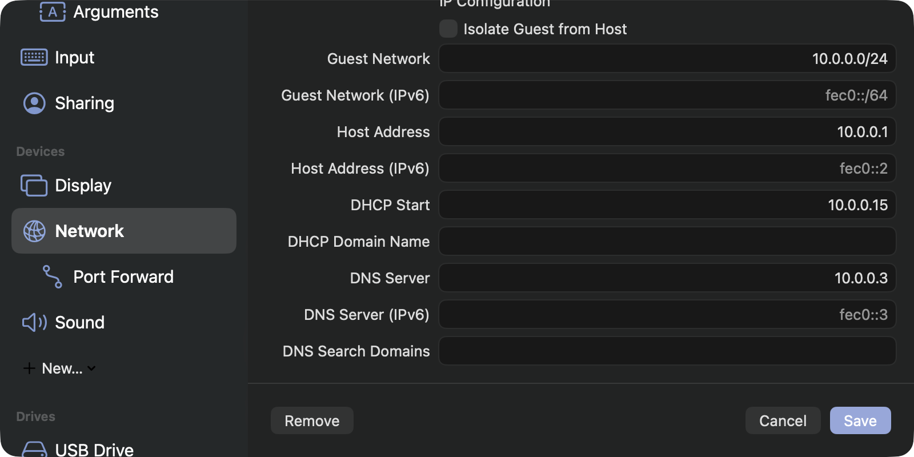
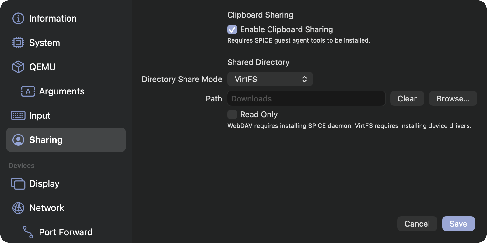
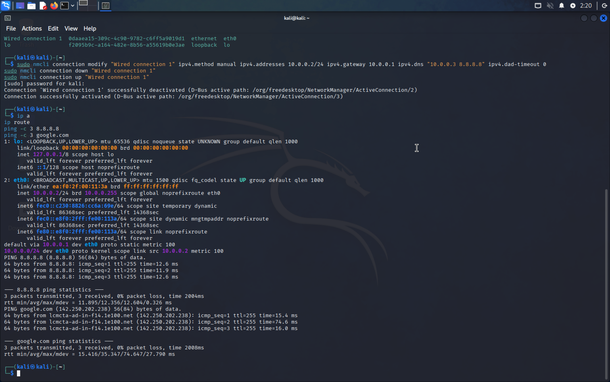
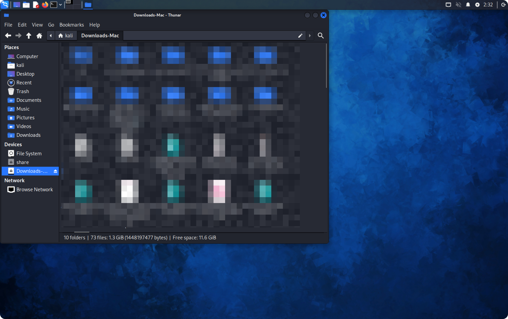
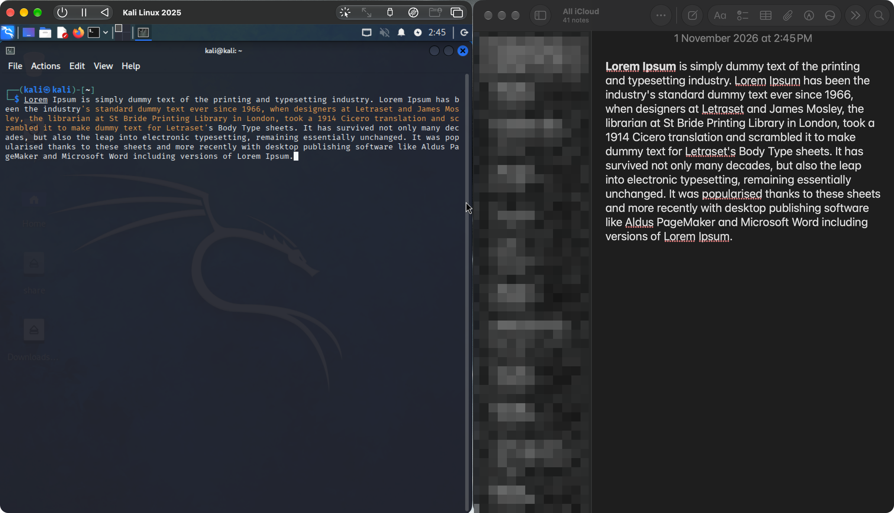

# Week 1: Cybersecurity Lab Setup

Task WK1-PM1: build an isolated testing lab with Kali Linux as the attacker machine.

I am on a Mac, so I used **UTM** instead of VirtualBox. UTM's *Emulated VLAN* network mode gives the same NAT-style network that VirtualBox NATNetwork provides.

Full report with captions: [WK1-PM1_Lab_Setup_Report.docx](WK1-PM1_Lab_Setup_Report.docx)

## Requirements and status

| Requirement | Status | Notes |
|-------------|--------|-------|
| Virtualization base | Done | UTM (QEMU) instead of VirtualBox |
| Kali Linux as attacker machine | Done | |
| Network subnet 10.0.0.0/24 | Done | Emulated VLAN, host/gateway 10.0.0.1 |
| Clipboard sharing | Done | Works both ways |
| Drag and drop | Not supported | UTM limitation on this setup, shared folder used instead |
| Shared folder (Downloads) | Done | VirtFS share, mounted in Kali |
| Kali IP 10.0.0.2/24 | Done | Static IP via NetworkManager |
| Full internet access | Done | 0% packet loss to 8.8.8.8 and google.com |
| VM snapshot | Not done | Mac ran out of free disk space |

## Setup steps

### 1. Network (UTM)

In the VM settings, Network:

- Network Mode: Emulated VLAN
- Guest Network: `10.0.0.0/24`
- Host Address: `10.0.0.1`
- DHCP Start: `10.0.0.15`
- DNS Server: `10.0.0.3`

### 2. Static IP in Kali

```bash
nmcli connection show
sudo nmcli connection modify "Wired connection 1" \
  ipv4.method manual \
  ipv4.addresses 10.0.0.2/24 \
  ipv4.gateway 10.0.0.1 \
  ipv4.dns "10.0.0.3 8.8.8.8" \
  ipv4.dad-timeout 0
sudo nmcli connection down "Wired connection 1"
sudo nmcli connection up "Wired connection 1"
```

### 3. Verify

```bash
ip a
ip route
ping -c 3 8.8.8.8
ping -c 3 google.com
```

### 4. Shared folder

UTM shares the Mac Downloads folder through VirtFS and it appears in Kali at `/mnt/macos`. The share is owned by my Mac user ID, so Kali's `kali` user was denied access. I fixed this with `bindfs`, which remaps ownership:

```bash
sudo apt install -y bindfs
mkdir -p ~/Downloads-Mac
sudo bindfs --force-user=kali --force-group=kali /mnt/macos /home/kali/Downloads-Mac
```

### 5. Clipboard

Clipboard sharing is enabled in UTM's Sharing settings, with the SPICE guest agent in Kali.

## Screenshots

| | |
|---|---|
| UTM network mode |  |
| UTM advanced network settings |  |
| UTM sharing settings |  |
| Static IP 10.0.0.2/24 and internet |  |
| Shared folder inside Kali |  |
| Clipboard test |  |

## What I learned

- How virtual machine networking works, including NAT and custom subnets
- DHCP versus static addressing, and setting a static IP with NetworkManager
- Why 9p/VirtFS shares fail with "Permission denied" when user IDs differ, and how bindfs fixes it
- Documenting a setup with evidence for each requirement

## Limitations

- **Drag and drop** is not supported by UTM on this setup. The shared folder is used for file transfer.
- **Snapshot** was not created because the Mac ran out of free disk space.
